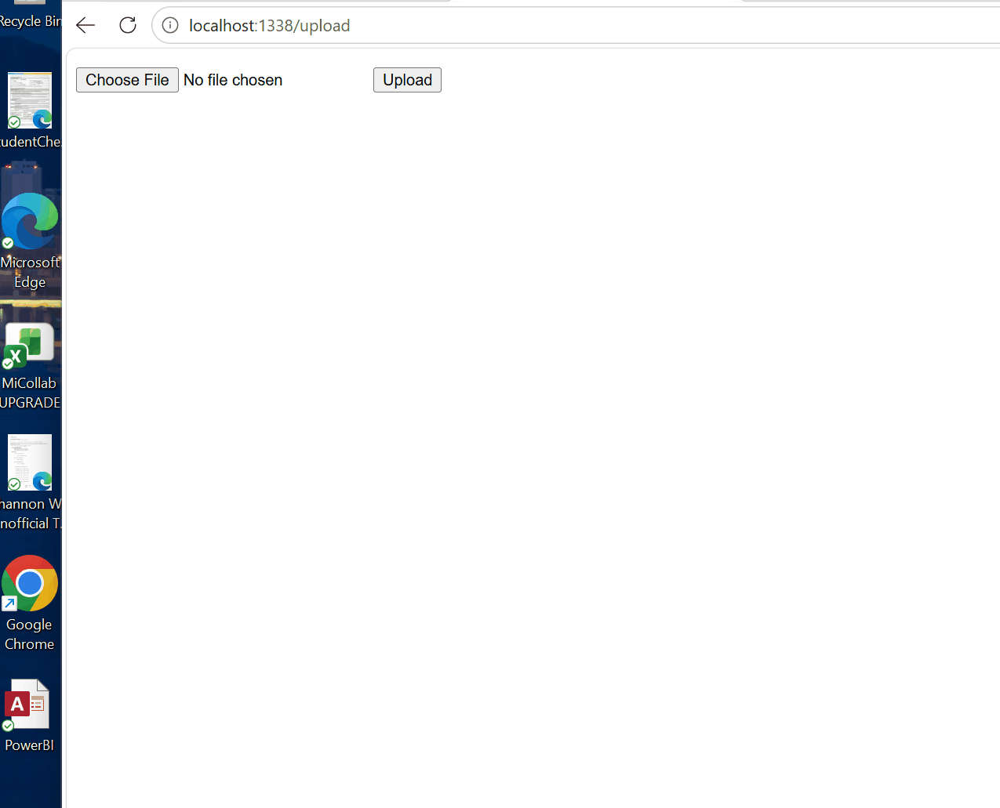

# Flask on Docker

[](https://github.com/shannonw34/flask-on-docker/actions/workflows/build.yml)

A containerized Flask web application built with Docker Compose, PostgreSQL, Gunicorn, and Nginx. The project demonstrates a development and production-ready multi-container architecture in which Flask handles application logic, PostgreSQL provides persistent database storage, Gunicorn serves the Flask application, and Nginx acts as a reverse proxy and serves static and uploaded media files directly. The application includes database-backed users, static-file serving, and image upload functionality, with Docker volumes used to share persistent data between services.

## Overview

This project was built as a hands-on exercise in containerizing a Flask application and designing a multi-service web architecture. The development environment uses Docker Compose to run Flask and PostgreSQL together, while the production configuration adds Gunicorn and Nginx for application serving and reverse proxying. Static assets and uploaded media are stored in shared Docker volumes so that Nginx can serve them directly without sending those requests through Flask.

### Application Demo

The following demonstration shows the application running, uploading an image, and then accessing the uploaded image through the media endpoint.



## Architecture

The application consists of the following services:

* **Flask** — Web application and API logic
* **PostgreSQL** — Relational database
* **Gunicorn** — Production WSGI application server
* **Nginx** — Reverse proxy and static/media file server
* **Docker Compose** — Service orchestration

### Request Flow

For application requests:

```text
Browser
   |
   v
 Nginx
   |
   v
Gunicorn
   |
   v
 Flask
   |
   v
PostgreSQL
```

For static files and uploaded media:

```text
Browser
   |
   v
 Nginx
   |
   +----> static_volume
   |
   +----> media_volume
```

## Build Instructions

### Prerequisites

You will need:

* Docker
* Docker Compose

Docker Desktop or a recent Docker Engine installation with the Docker Compose plugin is recommended.

### Development

Clone the repository and enter the project directory:

```bash
git clone https://github.com/shannonw34/flask-on-docker.git
cd flask-on-docker
```

Build and start the development services:

```bash
docker compose up -d --build
```

The development configuration starts:

* Flask web application on port `5002`
* PostgreSQL on its internal Docker network

Open the application at:

```text
http://localhost:5002/
```

To test image uploads, visit:

```text
http://localhost:5002/upload
```

After uploading an image, it can be accessed at:

```text
http://localhost:5002/media/IMAGE_FILE_NAME
```

To view running containers:

```bash
docker compose ps
```

To view application logs:

```bash
docker compose logs -f web
```

To stop the development environment:

```bash
docker compose down
```

### Production

The production configuration uses Gunicorn and Nginx:

```bash
docker compose -f docker-compose.prod.yml up -d --build
```

Initialize the database:

```bash
docker compose -f docker-compose.prod.yml exec web python manage.py create_db
```

The production Nginx service is exposed on port `1338` in this deployment:

```text
http://localhost:1338/
```

Image uploads are available at:

```text
http://localhost:1338/upload
```

Uploaded media can be accessed at:

```text
http://localhost:1338/media/IMAGE_FILE_NAME
```

To stop the production environment:

```bash
docker compose -f docker-compose.prod.yml down
```

> **Security:** Production database credentials are intentionally excluded from this repository. The `.env.prod.db` file is ignored by Git and must be created locally before starting the production database.

## Project Structure

```text
flask-on-docker/
├── .github/
│   └── workflows/
│       └── build.yml
├── services/
│   ├── nginx/
│   │   ├── Dockerfile
│   │   └── nginx.conf
│   └── web/
│       ├── Dockerfile
│       ├── Dockerfile.prod
│       ├── entrypoint.sh
│       ├── entrypoint.prod.sh
│       ├── manage.py
│       ├── requirements.txt
│       └── project/
│           ├── __init__.py
│           ├── config.py
│           ├── media/
│           └── static/
├── docker-compose.yml
├── docker-compose.prod.yml
├── .env.dev
├── .env.prod
├── .gitignore
└── README.md
```

## Technologies

* Python
* Flask
* Flask-SQLAlchemy
* PostgreSQL
* Gunicorn
* Nginx
* Docker
* Docker Compose
* GitHub Actions

## What I Learned

This project provided practical experience with containerizing a Python web application, orchestrating multiple services with Docker Compose, configuring development and production environments, using PostgreSQL from a containerized Flask application, serving applications through Gunicorn and Nginx, and managing persistent static and media files with Docker volumes.

